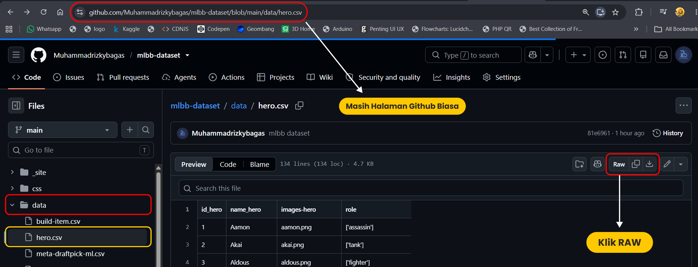
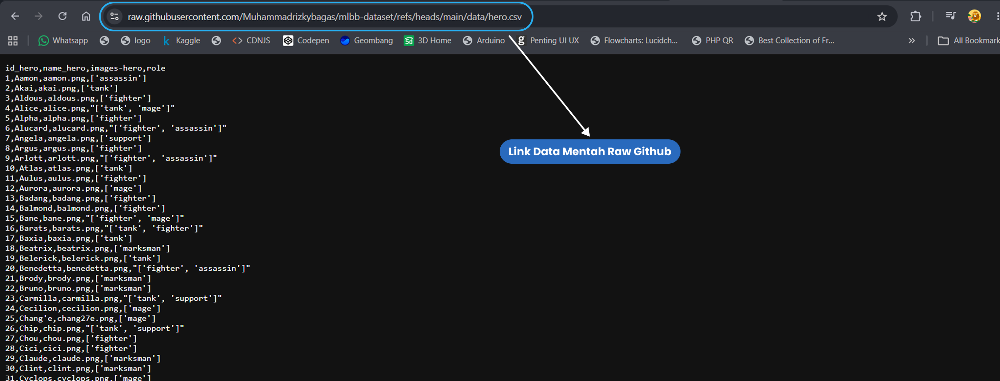

```{r, echo=FALSE, message=FALSE, warning=FALSE}

library(DiagrammeR)
library(DT)
library(knitr)
library(base64enc)
library(ggplot2)

```


# Apa Itu Dataset

Kumpulan data yang disusun dalam bentuk tabel, sehingga bisa dipakai untuk
analisis. Sebuah dataset biasanya terdiri dari:

- `Baris (rows)`: satu baris = satu observasi atau satu data.
- `Kolom (columns)`: satu kolom = satu variabel atau atribut


Contoh dataset kecil:

| **Name**    | **Role**     |
| ----------- | ------------ |
| Miya        | Marksman     |
| Balmond     | Fighter      |
| Saber       | Assassin     |
| Alice       | Mage         |
| Tigreal     | Tank         |

Pada latihan ini kita memakai dataset **hero Mobile Legends**. Datasetnya berisi 133 hero dan
disimpan di GitHub.


---


# Kenapa Dataset Disimpan di GitHub?

Dataset bisa disimpan di *repository* GitHub supaya bisa diakses lewat internet. Alurnya seperti ini:

```{r, echo=FALSE, message=FALSE, warning=FALSE}

grViz("
digraph github_to_r {

  graph [
    rankdir = TB,
    bgcolor = 'transparent',
    margin = 0.2,
    nodesep = 0.35,
    ranksep = 0.45
  ]

  node [
    shape = box,
    style = 'rounded,filled',
    fontname = 'Arial',
    fontsize = 16,
    margin = '0.3,0.18',
    width = 3.8,
    color = '#1F4E78',
    penwidth = 1.8
  ]

  edge [
    color = '#555555',
    penwidth = 1.8,
    arrowsize = 0.7
  ]

  github [
    label = 'GitHub Repository',
    fillcolor = '#EAF2F8'
  ]

  csv [
    label = 'dataset.csv',
    fillcolor = '#EAF2F8'
  ]

  rawfile [
    label = 'Raw File',
    fillcolor = '#EAF2F8'
  ]

  rawurl [
    label = 'Raw URL',
    fillcolor = '#FFF3CD'
  ]

  r [
    label = 'R',
    fillcolor = '#EAF2F8'
  ]

  dataset [
    label = 'Dataset',
    fillcolor = '#FFF3CD',
    fontsize = 18
  ]

  github -> csv
  csv -> rawfile
  rawfile -> rawurl
  rawurl -> r
  r -> dataset
}
")

```


:::{.callout-note title="Keuntungannya"}
File dataset tidak perlu dipindahkan manual ke setiap komputer. Selama URL masih bisa dibuka, R bisa mengambil datanya langsung.
:::


---


# URL Halaman GitHub vs URL Raw

Ini hal yang paling penting: URL halaman GitHub dan URL raw itu berbeda


:::{.callout-tip title="URL Halaman Github"}

Dipakai untuk melihat file lewat browser. Contoh:


> <a href="https://github.com/Muhammadrizkybagas/mlbb-dataset/blob/main/data/hero.csv">https://github.com/Muhammadrizkybagas/mlbb-dataset/blob/main/data/hero.csv</a>



Halaman ini berisi tampilan website GitHub (menu, tombol, dll), bukan data mentah. Karena itu R
tidak bisa membaca data dari URL ini.

:::


---


:::{.callout-note title="URL Raw Github"}

Hanya berisi isi file (data mentahnya saja). Inilah yang dibutuhkan R:

Formatnya:

<a href="https://raw.githubusercontent.com/Muhammadrizkybagas/mlbb-dataset/refs/heads/main/data/hero.csv">https://github.com/Muhammadrizkybagas/mlbb-dataset/blob/main/data/hero.csv </a>



:::


---


:::{.callout-tip title="Tips"}
cara cepat mengenali URL raw adalah dari alamatnya. Kalau diawali `github.com` berarti URL
halaman biasa. Kalau diawali `raw.githubusercontent.com` berarti URL raw.
:::


---


# Membaca Dataset


Sekarang kita baca datanya di R. Tulis kode berikut di chunk R pada file .qmd kamu:

```{r, message=FALSE, warning=FALSE}
# baca dataset hero dari raw GitHub
url_hero <-
 "https://raw.githubusercontent.com/Muhammadrizkybagas/mlbb-dataset/refs/heads/main/data/hero.csv"
data_hero <- read.csv(url_hero, stringsAsFactors = FALSE)

```

- `url_hero`: variabel untuk menyimpan alamat raw URL.
- `read.csv()`: fungsi untuk membaca file CSV, bisa dari file lokal maupun dari URL.
- `stringsAsFactors` = `FALSE`: supaya kolom teks tetap dibaca sebagai teks biasa.
- `data_hero`: tempat hasil baca disimpan (berupa data frame).

Setelah itu, cek isi datanya dulu sebelum dipakai:


```{r, message=FALSE, warning=FALSE}
head(data_hero) # lihat 6 baris pertama
nrow(data_hero) # jumlah baris (hasilnya 133)
names(data_hero) # nama kolom
```


---


# Menampilkan Gambar Hero

Kolom `images.hero` baru berisi nama file gambar (misalnya `aamon.png`). Supaya tampil
sebagai gambar, kita ubah nama file itu menjadi tag HTML `` dengan `paste0()`.


```{r, message=FALSE, warning=FALSE}
# alamat folder gambar di GitHub (raw URL)
image_base <-
 "https://raw.githubusercontent.com/Muhammadrizkybagas/mlbb-dataset/refs/heads/main/img/images-hero/"

# ubah nama file menjadi tag gambar
data_hero$images.hero <- paste0(
 ''
)
```


---


# Menampilkan Dataset

Fungsi `datatable()` berasal dari package **DT**. Jika belum pernah dipasang, jalankan sekali di
Console:

> `install.packages("DT")`

Lalu panggil library-nya dan tampilkan tabel:

```{r, message=FALSE, warning=FALSE}

library(DT)
datatable(
 data_hero,
 escape = FALSE, # agar tag  dibaca sebagai gambar
 filter = "top", # kotak filter di atas tiap kolom
 rownames = FALSE, # sembunyikan nomor baris bawaan
 options = list(
 pageLength = 5, # tampilkan 5 baris per halaman
 scrollX = TRUE # tabel bisa digeser ke samping
 )
)


```

Hasilnya adalah tabel interaktif: kamu bisa mencari data (search), memfilter per kolom,
mengurutkan, dan berpindah halaman. Dataset hero ini terdiri dari 133 data, jadi akan muncul
sekitar 27 halaman dengan 5 baris per halaman.


---


# Kode Lengkap


Salin URL dan data raw github dapat digunakan. Lihat kode di bawah ini.

```{r, message=FALSE, warning=FALSE}

data <- read.csv(
  "https://raw.githubusercontent.com/Muhammadrizkybagas/mlbb-dataset/refs/heads/main/data/hero.csv"
)

# url gambar
image_base <- "https://raw.githubusercontent.com/Muhammadrizkybagas/mlbb-dataset/refs/heads/main/img/images-hero/"

# Ubah nama file menjadi gambar
data$images.hero <- paste0(
  ''
)

datatable(
  data,
  escape = FALSE,
  filter = "top",
  rownames = FALSE,
  options = list(
    pageLength = 5,
    scrollX = TRUE
  )
)
```


# Kesalahan Yang Sering Terjadi


| Masalah | Kemungkinan Penyebab |
|---|---|
| Error saat read.csv() | Memakai URL GitHub, bukan URL raw. |
| Error datatable | Belum menjalankan library(DT). |


# Ringkasan

- Dataset bisa disimpan di GitHub dan dibaca langsung oleh R.
- Gunakan raw URL (raw.githubusercontent.com), bukan URL halaman biasa.
- Baca data dengan read.csv(url).
- Tampilkan tabel interaktif dengan datatable() dari package DT.
- Pakai escape = FALSE jika kolom berisi tag HTML seperti gambar


