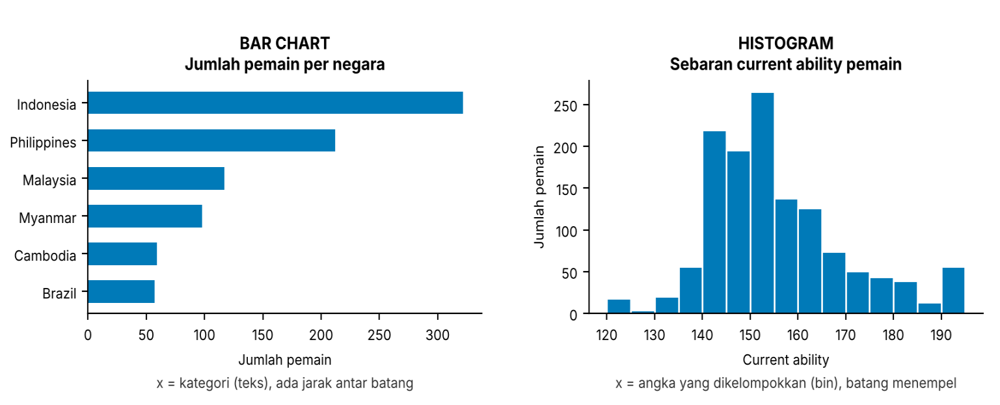

```{r, echo=FALSE, message=FALSE, warning=FALSE}

library(DiagrammeR)
library(DT)
library(knitr)
library(base64enc)
library(ggplot2)
library(tidyverse)

```

Di bab ini kita tidak hanya belajar membuat grafik, tetapi belajar menjawab satu pertanyaan:

> Grafik apa yang paling tepat untuk data dan pertanyaan yang kita punya?

Setelah bab ini, kamu bisa:

- Menentukan pertanyaan sebelum membuat grafik,
- Memilih jenis grafik yang sesuai dengan jenis data dan pertanyaannya,
- Membuat beberapa jenis grafik dengan `ggplot2` di R.


---


# Mulai dari Pertanyaan

Sebelum membuat grafik, tentukan dulu apa yang ingin dijawab. Contoh:

> "Lane mana yang memiliki hero S-Tier paling banyak?" - butuh data `lane` dan `priority_tier`.

> "Apakah pemain dengan kemampuan lebih tinggi punya market value lebih besar?" berarti kita butuh dua
kolom angka: `current_ability` dan `market_value_usd`.


:::{.callout-tip title="Tips"}
Prinsip sederhana: start with a question, not a chart. Jangan pilih grafik dulu, lalu mencari alasan untuk
memakainya.
:::


## Dataset yang Digunakan

| **Dataset**             | **Contoh variabel**                                 |
| ----------------------- | --------------------------------------------------- |
| `meta-draftpick-ml.csv` | `lane`, `priority_tier`, `hero_name`                |
| `players.csv`           | `role`, `country`, `winnings`                       |
| `stat-player.csv`       | `current_ability`, `market_value_usd`, `star_power` |
| `build-item.csv`        | `battle_spell`, `item_1`–`item_6`, `role`           |
| `tournament.csv`        | `name_turnament`, `prize_pool`, `location`          |


Panggil library dan baca semua dataset sekali di awal. Gunakan raw URL seperti di
Chapter 1.

```{r, message=FALSE, warning=FALSE}

library(tidyverse) # berisi ggplot2, dplyr, tidyr, stringr
library(scales) # untuk format angka (comma)

url_data <- "https://raw.githubusercontent.com/Muhammadrizkybagas/mlbb-dataset/refs/heads/main/data/"
meta <- read.csv(paste0(url_data, "meta-draftpick-ml.csv"))
build <- read.csv(paste0(url_data, "build-item.csv"))
players <- read.csv(paste0(url_data, "players.csv"))
stat <- read.csv(paste0(url_data, "stat-player.csv"))


# nama kolom di stat-player.csv
stat <- stat %>%
  rename(
    role = player_info_role,
    current_ability = hidden_and_non_technical_hidden_current_ability,
    market_value_usd = hidden_and_non_technical_business_market_value_usd
 )

```


:::{.callout-warning title="Perhatikan"}
Jika `library(tidyverse)` belum terpasang, jalankan sekali di Console:
`install.packages("tidyverse")`. Untuk scales sama: `install.packages("scales")`.
:::


---

# Memilih Grafik

Cara paling cepat memilih grafik: lihat bentuk pertanyaannya.


| Pertanyaan yang ingin dijawab | Grafik | Contoh dari dataset |
|---|---|---|
| Mana yang paling banyak / sedikit? Bandingkan antar kategori | **Bar chart** | Hero S-Tier per lane |
| Bagaimana sebaran data angka? Di mana data paling banyak? | **Histogram** | Sebaran current ability |
| Berapa proporsi tiap bagian terhadap total? (maks. 5-6 kategori) | **Pie / Donut chart** | Proporsi role hero |
| Bagaimana perubahan berdasarkan urutan atau waktu? | **Line chart** | Jumlah pemain per tahun lahir |
| Apakah dua angka saling berhubungan? | **Scatter plot** | Ability vs market value |
| Bagaimana sebaran angka antar kelompok? | **Box plot** | Ability pemain per role |


---


## Bar Chart

:::{.callout-note title="Bar Chart"}
Membandingkan nilai antar kategori. Cocok untuk pertanyaan: mana yang paling banyak? mana yang paling sedikit? bagaimana perbedaan antar kategori?
:::


### Hero S-Tier di Setiap Lane

> "Lane mana yang memiliki hero S-Tier paling banyak?"

```{r, message=FALSE, warning=FALSE}

# filter hero S-Tier, lalu hitung jumlahnya per lane
lane_s <- meta %>%
  filter(priority_tier == "S-Tier") %>%
  count(lane)

ggplot(lane_s, aes(x = reorder(lane, -n), y = n)) +
  geom_col(fill = "#007AB8") +
  geom_text(aes(label = n), vjust = -0.3) +
  labs(
    title = "Jumlah Hero S-Tier di Setiap Lane",
    x = "Lane",
    y = "Jumlah Hero"
 )

```


:::{.callout-note title="Hasil"}
**Jungler** dan **Roamer** punya hero S-Tier terbanyak (masing-masing 5), disusul gold lane (4),
lalu exp lane dan mid lane (masing-masing 3). Dengan bar chart, perbandingan ini terbaca sekilas,
tidak perlu membaca daftar hero satu per satu.
:::


---


### Item yang Sering Dipakai

> "Item apa yang paling sering muncul di build hero?"


```{r, message=FALSE, warning=FALSE}

item_count <- build %>%
  select(starts_with("item_")) %>%                          # ambil kolom item_1 - item_6
  pivot_longer(cols = everything(),
               names_to = "slot", values_to = "item") %>%
  filter(!is.na(item), item != "") %>%                      # buang item kosong
  count(item, sort = TRUE) %>%                              # hitung tiap item
  slice_head(n = 10)                                        # ambil 10 teratas


ggplot(item_count, aes(x = reorder(item, n), y = n)) +
  geom_col(fill = "#2E75B6") +
  geom_text(aes(label = n), hjust = -0.2) +
  coord_flip() +                                            # jadikan batang horizontal
  expand_limits(y = max(item_count$n) * 1.1) +              # beri ruang untuk label angka
  labs(title = "10 Item yang Paling Sering Muncul",
       x = "Item", y = "Frekuensi")


```

:::{.callout-note title="Hasil"}
Tough Boots paling sering muncul (89 kali), disusul Holy Crystal (77) dan Oracle (74).
:::


:::{.callout-warning title="Penting"}
Kalau nama kategori panjang (seperti nama item), gunakan bar chart horizontal dengan
`coord_flip()` agar label tidak bertabrakan.
:::


## Histogram

:::{.callout-note title="Histogram"}
Melihat sebaran data angka: di rentang mana data paling banyak, apakah simetris atau miring, dan apakah ada nilai yang menonjol.
:::

> "Bagaimana sebaran current ability para pemain?"

```{r, message=FALSE, warning=FALSE}

ggplot(stat, aes(x = current_ability)) +
  geom_histogram(binwidth = 5, boundary = 120,
                 fill = "#007AB8", color = "white") +
  
 labs(
  title = "Sebaran Current Ability Pemain",
  x = "Current Ability",
  y = "Jumlah Pemain"
 )


```

:::{.callout-note title="Hasil"}

Current ability berkisar 120 sampai 192. Kebanyakan pemain ada di kisaran 140-165 dengan puncak sekitar nilai 150, lalu makin tinggi ability makin sedikit pemainnya. Ada lonjakan kecil di ujung kanan (sekitar 190-195).

:::


:::{.callout-warning title="Coba Sendiri"}

Ubah `binwidth` menjadi 2 dan 10. Bin terlalu kecil membuat grafik bergerigi, bin terlalu
besar menyembunyikan bentuk sebaran. Pilih yang paling jelas menunjukkan pola.

:::


### Histogram dan Barchart

Keduanya sama-sama berbentuk batang, jadi sering tertukar. Bedanya ada pada **data di sumbu x**.



|  | Bar chart | Histogram |
|---|---|---|
| Data di sumbu x | Kategori (teks), misal negara atau role | Angka yang dikelompokkan jadi rentang (bin) |
| Jarak antar batang | Ada jarak | Menempel, tanpa jarak |
| Urutan batang | Boleh diurutkan bebas (misal dari terbesar) | Tetap mengikuti urutan angka |
| Tujuan | Membandingkan kategori | Melihat bentuk sebaran data |
| Fungsi ggplot2 | `geom_col()` atau `geom_bar()` | `geom_histogram()` |
| Contoh | Jumlah pemain per negara | Sebaran current ability |


:::{.callout-tip title="Cara Cepat Membedakan"}

Tanya: **sumbu x-nya kategori atau angka?** Kategori = bar chart. Angka kontinu = histogram.

:::


---

## Pie Chart dan Donut Chart

:::{.callout-note title="Pie Chart dan Donut Chart"}
menunjukkan **proporsi** tiap bagian terhadap total (100%). Cocok kalau kategorinya sedikit, maksimal 5-6, dan kita hanya ingin melihat bagian mana yang dominan.
:::

> "Bagaimana komposisi role hero dalam dataset build?"


### Pie Chart

Satu build bisa punya dua role (contoh: *Fighter*, *Assassin*). Kita pisahkan dulu dengan `separate_rows()`, sehingga build itu dihitung di kedua role.

```{r, message=FALSE, warning=FALSE}

role_count <- build %>%
  separate_rows(role, sep = ",\\s*") %>% # pisahkan role yang berisi dua nilai
  count(role) %>%
  mutate(persen = n / sum(n) * 100)


# Pie chart
ggplot(role_count, aes(x = "", y = n, fill = role)) +
  geom_col(width = 1, color = "white") +
  geom_text(aes(label = paste0(round(persen, 1), "%")),
            position = position_stack(vjust = 0.5), color = "white") +
  coord_polar(theta = "y") +
  labs(title = "Proporsi Role Hero dalam Dataset Build", fill = "Role") +
  theme_void()

```


### Donut Chart 

Ubah `x = ""` menjadi `x = 2`, lalu tambahkan `xlim(0.5, 2.5)` di bawah `coord_polar()`.

```{r, message=FALSE, warning=FALSE}

ggplot(role_count, aes(x = 2, y = n, fill = role)) +
  geom_col(width = 1, color = "white") +
  geom_text(aes(label = paste0(round(persen, 1), "%")),
            position = position_stack(vjust = 0.5), color = "white") +
  coord_polar(theta = "y") +
  xlim(0.5, 2.5) +
  labs(title = "Proporsi Role Hero dalam Dataset Build", fill = "Role") +
  theme_void()
  
```

:::{.callout-note title="Hasil"}

Fighter paling dominan (27,6%), diikuti Mage (18,1%) dan Assassin (17,9%). Support paling
kecil (8,2%).

:::


:::{.callout-warning title="Ingat"}

**Kapan jangan pakai pie?** Kalau kategori lebih dari 6, atau selisih antar bagian kecil dan perlu
dibandingkan teliti.

:::


---


## Line Chart


:::{.callout-note title="Line Chart"}
Menunjukkan perubahan atau pola berdasarkan urutan yang bermakna, terutama waktu. Garis menghubungkan titik-titik yang berurutan.
:::


> "Bagaimana jumlah pemain berubah dari tahun lahir ke tahun lahir?"


Kolom `birthday` berisi teks seperti October 13, 2005 (age 20). Kita ambil 4 angka tahunnya
dengan `str_extract()`.


```{r, message=FALSE, warning=FALSE}

birth <- players %>%
  mutate(tahun_lahir = as.numeric(str_extract(birthday, "\\d{4}"))) %>%
  filter(!is.na(tahun_lahir), tahun_lahir >= 1994) %>% # sebelum 1994 datanya sangat sedikit
  count(tahun_lahir)


ggplot(birth, aes(x = tahun_lahir, y = n)) +
  geom_line(color = "#2E75B6", linewidth = 1.2) +
  geom_point(color = "#2E75B6", size = 3) +
  scale_x_continuous(breaks = seq(1994, 2010, by = 2)) +
  labs(
    title = "Jumlah Pemain Berdasarkan Tahun Lahir",
    x = "Tahun Lahir",
    y = "Jumlah Pemain"
 )

```

:::{.callout-note title="Hasil"}

jumlah pemain naik dari kelahiran 1994 sampai puncaknya di 2004 (115 pemain), lalu turun. Data ini hanya mencakup pemain yang mencantumkan tanggal lahir (694 pemain).

:::


:::{.callout-warning title="Syarat Line Chart"}

Sumbu x harus berurutan **(waktu atau angka)**. Jangan pakai untuk kategori yang tidak berurutan, misalnya **jumlah hero per lane**.

:::


---


## Scatter Plot


:::{.callout-note title="Line Chart"}
Melihat hubungan antara dua variabel angka. Setiap titik mewakili satu data (di sini, satu pemain).
:::

> "Apakah pemain dengan kemampuan lebih tinggi memiliki market value yang lebih besar?"


```{r, message=FALSE, warning=FALSE}

ggplot(stat, aes(x = current_ability, y = market_value_usd)) +
  geom_point(alpha = 0.4, color = "#2E75B6") +
  geom_smooth(method = "lm", se = FALSE, color = "#E4572E") +   # garis tren
  scale_y_log10(labels = comma) +                               # skala log di sumbu y
  labs(
    title = "Current Ability vs Market Value",
    x = "Current Ability",
    y = "Market Value (USD, skala log)"
 )


```


:::{.callout-note title="Hasil"}

Titik-titik naik dari kiri bawah ke kanan atas. Artinya makin tinggi current ability, makin tinggi market value (hubungan positif yang kuat).

:::


:::{.callout-warning title="Hati-hati"}

Hubungan antara dua angka belum tentu sebab-akibat. Scatter plot hanya menunjukkan bahwa keduanya bergerak bersama.

:::


---


## Box Plot


:::{.callout-note title="Box Plot"}
Melihat hubungan antara dua variabel angka. Setiap titik mewakili satu data (di sini, satu pemain).
:::

> "Apakah current ability berbeda antar role pemain?"

```{r, message=FALSE, warning=FALSE}

role_utama <- c("Roamer", "Mid Laner", "EXP Laner", "Gold Laner", "Jungler")


stat %>%
  filter(role %in% role_utama) %>%
  ggplot(aes(x = role, y = current_ability)) +
  geom_boxplot(fill = "#9CC3E6") +
  labs(
    title = "Current Ability Pemain per Role",
    x = "Role",
    y = "Current Ability"
 )

```

:::{.callout-tip title="Cara Membaca Box Plot"}

- **Kotak** = 50% data di tengah (dari kuartil 1 sampai kuartil 3).
- **Garis tebal di dalam kotak** = median (nilai tengah).
- **Garis di atas dan bawah kotak** = rentang data yang wajar.
- **Titik terpisah** = outlier, yaitu nilai yang jauh dari kebanyakan data.

:::


:::{.callout-note title="Hasil"}

Kelima role punya median yang hampir sama (sekitar 152-154). Jadi role pemain tidak membuat current ability berbeda jauh. Titik-titik di bagian atas adalah pemain dengan ability sangat tinggi.

:::


# Kesalahan yang Sering Terjadi

| Kesalahan | Perbaikan |
|---|---|
| Pie chart dengan banyak kategori | Pakai bar chart, maksimal 5-6 bagian untuk pie |
| Line chart untuk kategori yang tidak berurutan | Pakai bar chart |
| Sumbu y bar chart tidak dimulai dari 0 | Mulai dari 0, supaya tinggi batang tidak menipu |
| Histogram dengan bin terlalu kecil atau terlalu besar | Coba beberapa `binwidth` dan pilih yang paling jelas |
| Memakai histogram untuk data kategori | Pakai bar chart |
| Terlalu banyak warna | Pakai satu warna, kecuali perlu membedakan kelompok |
| Tanpa judul dan label sumbu | Selalu isi `labs(title, x, y)` |


# Ringkasan

- Mulai dari pertanyaan, bukan dari grafik.
- Bar chart untuk membandingkan kategori, histogram untuk melihat sebaran angka.
- Pie/donut untuk proporsi dengan kategori sedikit, line chart untuk data berurutan atau waktu.
- Scatter plot untuk hubungan dua angka, box plot untuk membandingkan sebaran antar
kelompok.
- Selalu beri judul dan label sumbu agar grafik bisa dipahami tanpa penjelasan.


