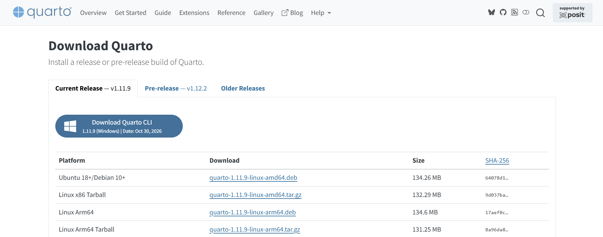
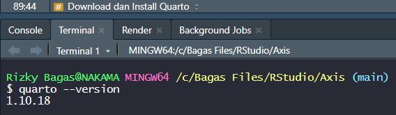
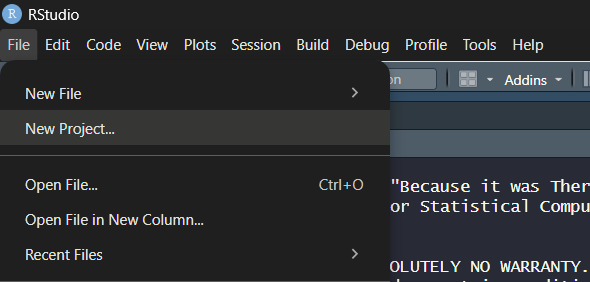
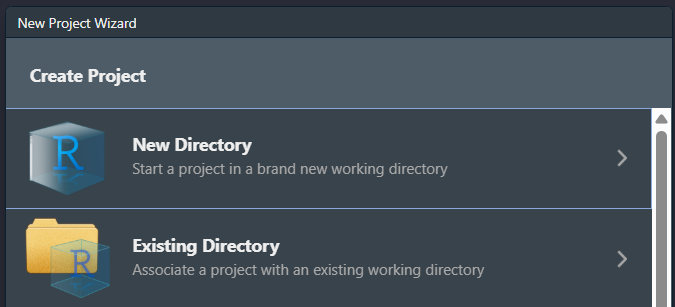
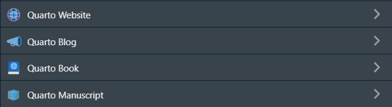
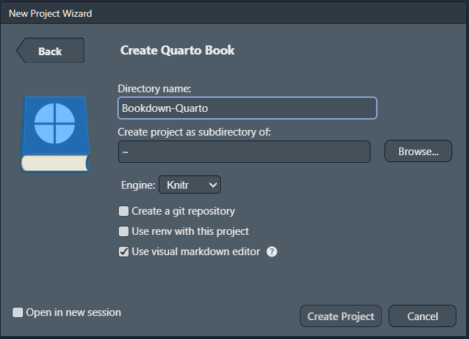
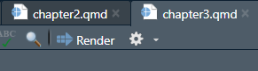

Berbeda dengan Bookdown yang menggunakan R Markdown (`.Rmd`), pada tutorial ini kita akan menggunakan format `.qmd` dan konfigurasi Quarto melalui file `_quarto.yml`.


# Gambaran tutorial


```{r, echo=FALSE, message=FALSE, warning=FALSE}
library(DiagrammeR)

# Flowchart
grViz("
digraph bookdown {

  graph [
    layout = dot,
    rankdir = TB,
    bgcolor = white,
    nodesep = 0.35,
    ranksep = 0.45
  ]

  node [
    shape = box,
    style = 'rounded,filled',
    fontname = 'Arial',
    fontsize = 16,
    color = '#800020',
    fillcolor = '#FFF9F2',
    fontcolor = '#333333',
    penwidth = 1.5,
    width = 4,
    height = 0.6
  ]

  edge [
    color = '#800020',
    penwidth = 1.5,
    arrowsize = 0.8
  ]

  step1 [label = '1. Download dan instal Quarto']
  step2 [label = '2. Memastikan Quarto terintegrasi dengan RStudio']
  step3 [label = '3. Membuat project baru di RStudio']
  step4 [label = '4. Membuat struktur folder dan file']
  step5 [label = '5. Membuat konfigurasi _quarto.yml']
  step6 [label = '6. Membuat halaman utama dan chapter .qmd']
  step7 [label = '7. Menjalankan Render']
  step8 [label = '8. Melihat hasil Bookdown melalui browser']

  step1 -> step2
  step2 -> step3
  step3 -> step4
  step4 -> step5
  step5 -> step6
  step6 -> step7
  step7 -> step8
}
")

```


:::{.callout-note title="Catatan"}
Quarto sebenarnya memiliki fitur Book Project sendiri. Jadi, kita akan menggunakan Quarto Book, yaitu pendekatan yang menghasilkan buku digital dengan navigasi bab seperti tampilan tutorial yang kamu tunjukkan.
:::


## Download dan Install Quarto

**Quarto** → perangkat lunak yang digunakan untuk mengolah file `.qmd` menjadi dokumen HTML, PDF, website, maupun buku digital.


:::{.callout-note title="Cara Instalasi"}
1. Buka browser (Chrome atau browser lainnya).
2. Kunjungi website resmi Quarto: <a href="https://quarto.org/docs/download/">Download Quarto.</a>
3. Pilih installer sesuai sistem operasi. Karena menggunakan Windows, pilih Windows Installer (.msi).
4. Tunggu sampai proses download selesai.
5. Buka file installer yang sudah diunduh.
6. Ikuti proses instalasi dengan menekan tombol Next hingga selesai.
7. Setelah instalasi selesai, Quarto sudah bisa digunakan.
:::





## Pastikan Quarto Terintegrasi dengan RStudio


Setelah Quarto berhasil diinstal, langkah berikutnya adalah memastikan RStudio dapat mengenali Quarto.

:::{.callout-tip title="Cek Quarto di RStudio"}

1. Buka aplikasi RStudio.
2. Pilih menu **Tools** → **Terminal** → **New Terminal**.
3. Ketik perintah berikut:

`quarto --version`

4. Tekan **Enter**.
5. Jika berhasil, terminal akan menampilkan nomor versi Quarto yang terinstal.

`1.10.18`
:::



> Jika nomor versi muncul, berarti Quarto sudah berhasil terinstal dan dapat dikenali oleh sistem.

:::{.callout-warning title="Perhatikan"}
Jika muncul pesan `quarto is not recognized`, tutup dan buka kembali RStudio. Jika masih terjadi, periksa instalasi dan PATH Quarto di Windows.


Packages yang perlu di install:

1. Bookdown
2. Quarto
:::


## Membuat Projek Baru

Selanjutnya, kita akan membuat project khusus untuk menyimpan seluruh file buku digital.

:::{.callout-tip title="Langkah-langkah"}

1. Buka RStudio
2. Klik menu **File** → **New Project**.



3. Pilih **New Directory**.



4. Pilih **Quarto Book** Project jika tersedia pada versi RStudio yang digunakan.



5. Isi nama project, misalnya:



6. Tentukan lokasi penyimpanan project.
7. Klik **Create Project**.

:::

> Setelah project berhasil dibuat, RStudio akan membuka project tersebut secara otomatis.

:::{.callout-warning title="Perhatikan"}
Jika pilihan Quarto Book tidak tersedia, kita tetap bisa membuat project kosong melalui New Directory, kemudian menambahkan konfigurasi Quarto secara manual pada tahap berikutnya.
:::


## Render Digital Book

Setelah semua file selesai dibuat, langkah selanjutnya adalah melakukan proses Render untuk mengubah seluruh file `.qmd` menjadi buku digital berbentuk HTML.

:::{.callout-tip title="Cara Render"}
1. Buka salah satu file `.qmd` di RStudio.
2. Klik tombol **Render** pada bagian atas Source Editor.
3. Tunggu sampai proses selesai.
4. Hasil dokumen akan ditampilkan melalui Viewer atau browser sesuai pengaturan RStudio.
:::




