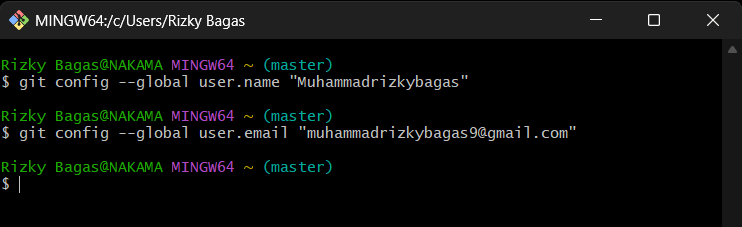
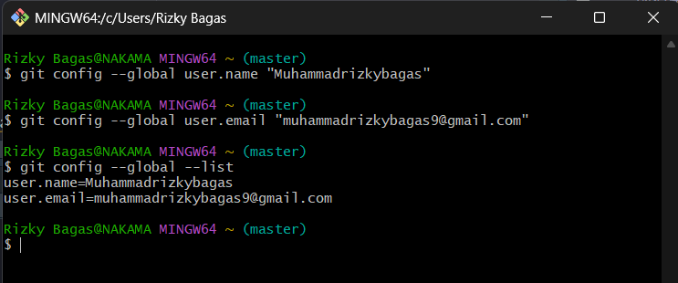
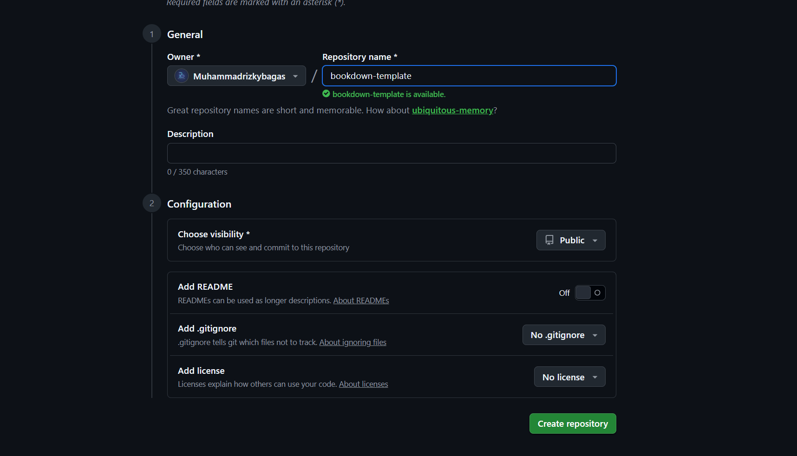
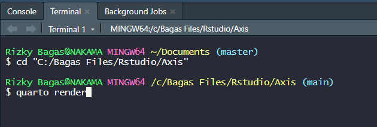
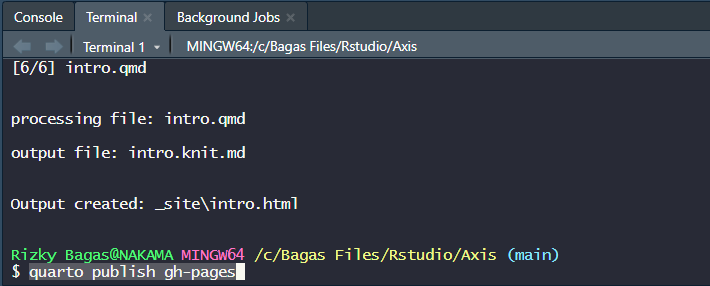

 

Pada tahap ini, kita akan mempelajari cara mengunggah project Quarto Book ke GitHub dan mempublikasikannya menggunakan GitHub Pages.

> Tujuannya adalah agar buku digital yang sebelumnya hanya bisa dibuka melalui komputer sendiri dapat diakses secara online melalui sebuah link website.


Prosesnya dibagi menjadi dua bagian:

1. **Push ke GitHub**: Mengunggah seluruh file project Quarto ke repository GitHub.
2. **Deploy ke GitHub Pages**: Mengubah hasil render Quarto menjadi website HTML yang dapat diakses secara publik.


---

# Persiapan Awal

1. Install Git: Unduh dan install <a href="https://git-scm.com/install">Git</a>.
2. Konfigurasi Identitas: Buka Git Bash, lalu masukkan nama dan email GitHub Anda:

:::{.callout-tip title="Buka Git Bash"}

`git config --global user.name "Username Github Kamu"`

`git config --global user.email "emailkamu@example.com"`



3. Cek apakah konfigurasi berhasil tersimpan:

`git config --global --list`

Harusnya ada hasilnya seperti ini:

`user.name=Muhammadrizkybagas`

`user.email=muhammadrizkybagas9@gmail.com`




:::


# Buat Repository Baru

Pertama, kita perlu membuat repository sebagai tempat penyimpanan project Quarto Book.

:::{.callout-note title="Langkah-langkah"}

1. Buka browser dan kunjungi <h href="https://github.com/">GitHub</a>.
2. Login menggunakan akun GitHub.
3. Klik tombol **New Repository**.
4. Isi nama repository, misalnya `Bookdown-Quarto`.
5. Pilih visibility repository menjadi **Public** agar website dapat diakses secara publik.
6. Jangan centang Add README, `.gitignore`, atau License jika project sudah memiliki file sendiri.
7. Klik **Create Repository**.`

:::




---


# Menghubungkan Project RStudio

Setelah repository berhasil dibuat, kita perlu menghubungkan folder project Quarto yang ada di komputer dengan repository GitHub.

:::{.callout-tip title="Langkah-langkah"}

1. Gunakan short cut `Windows + R` untuk membuka **Command Prompt**.
2. Pastikan path folder sudah direct ke folder bookdown quarto.
3. Jalankan perintah berikut:

`git init`

`git add .`

`git commit -m "Initial commit`

Perintah tersebut berfungsi untuk:

- `git init`: Mengaktifkan Git pada folder project.
- `git add .`: Menyiapkan seluruh file untuk diunggah.
- `git commit`: Menyimpan perubahan project ke dalam riwayat Git.

Selanjutnya, hubungkan project dengan repository GitHub yang sudah dibuat.

Salin URL repository GitHub, kemudian jalankan:

`git branch -M main`

`git remote add origin https://github.com/Muhammadrizkybagas/bookdown-template.git`

`git push -u origin main`

:::


# Render Project

Sebelum dipublikasikan, kita perlu memastikan seluruh materi dapat di-render dengan baik.

:::{.callout-tip title="Langkah-langkah"}

1. Buka kembali **Terminal** di RStudio.
2. Pastikan terminal berada di direktori utama project.
3. Jalankan perintah:

`quarto render`



4. Tekan Enter.
5. Tunggu hingga proses render selesai.
6. Pastikan tidak ada pesan error.

:::


# Pubslih ke Github Pages

Setelah proses render berhasil, kita akan mempublikasikan buku digital menggunakan perintah `quarto publish gh-pages`.

:::{.callout-tip title="Langkah-langkah"}

1. Pastikan Terminal masih berada di folder utama project.
2. Pastikan kita sedang berada di branch main, bukan gh-pages.
3. Jalankan perintah berikut:

`quarto publish gh-pages`



4. Tekan Enter.
5. Jika muncul konfirmasi publikasi, ketik Y atau pilih Yes.
6. Tunggu sampai proses render dan publish selesai.
7. Jika diminta melakukan autentikasi GitHub, ikuti petunjuk yang muncul.

:::

**Apa yang terjadi ketika perintah dijalankan?**

- Quarto melakukan render project.
- Hasil HTML disiapkan untuk publikasi.
- Quarto membuat branch gh-pages jika belum tersedia.
- Hasil website diunggah ke GitHub.
- GitHub Pages memproses website agar dapat diakses secara online.

:::{.callout-note title="Catatan"}
Perlu diketahui bahwa `quarto publish gh-pages` secara default sudah melakukan render ulang. Jadi, `quarto render` sebelumnya berfungsi untuk memastikan project berhasil dibangun sebelum dipublikasikan.
:::


# Update Website Jika Ada Perubahan

Jika mahasiswa melakukan perubahan materi atau menambahkan bab baru, website perlu diperbarui agar menampilkan versi terbaru.

:::{.callout-tip title="Update Website"}
Jalankan perintah berikut melalui Terminal RStudio:

> Menyimpan perubahan ke GitHub
git add .
git commit -m "Update materi Quarto Book"
git push origin main


> Render dan publish ulang
`quarto render`
`quarto publish gh-pages`
:::


Setelah proses selesai, buka kembali URL GitHub Pages. Website akan menampilkan materi terbaru.


# Rangkuman Alur Publikasi

**Workflow Publish Quarto Book**

1. **Buat repository GitHub**

   Menyiapkan tempat penyimpanan project.
2. **Push project ke GitHub**

   Mengunggah file `.qmd`, `_quarto.yml`, dan file pendukung ke branch main.
3. **Render project**

   Menjalankan `quarto render` untuk menghasilkan HTML.
4. **Publish ke GitHub Pages**

   Menjalankan `quarto publish gh-pages` untuk mengunggah hasil website.
5. **Website berhasil di-deploy**

   Buku digital dapat diakses melalui URL GitHub Pages.
   

PERINTAH UTAMA

```
quarto render
quarto publish gh-pages

```


