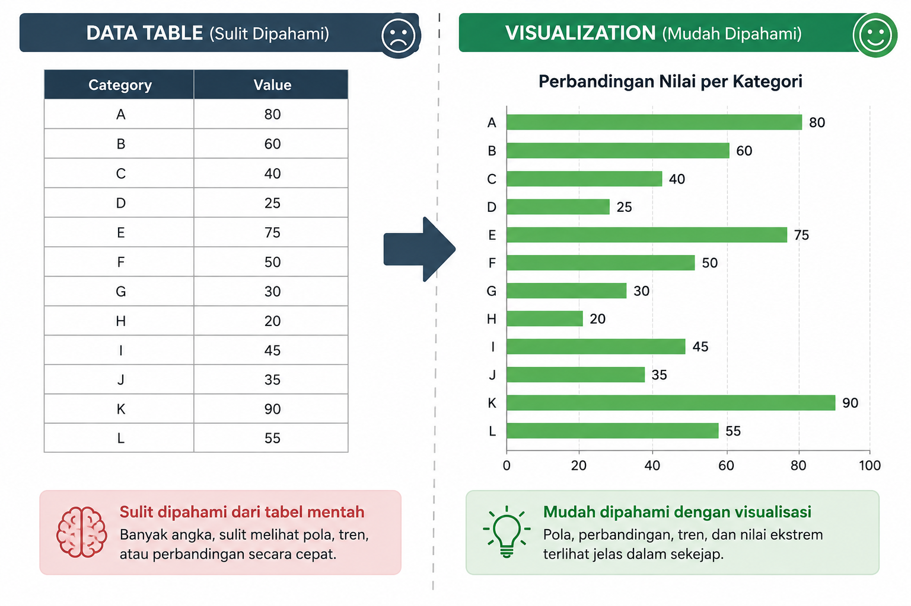

```{r, echo=FALSE, message=FALSE, warning=FALSE}

library(ggplot2)
library(DiagrammeR)

```


Pada bagian ini, kita akan mengenal dasar-dasar visualisasi data.
Fokusnya bukan pada membuat grafik sebanyak mungkin, tetapi memahami mengapa, kapan, dan bagaimana sebuah grafik digunakan.


# Apa Itu Data Visualization

Data visualization adalah proses menyajikan data dalam bentuk visual agar informasi lebih mudah dipahami.
Visualisasi dapat berupa `grafik`, `diagram`, `peta`, `tabel`, `dashboard`

Tujuan utamanya adalah membantu kita melihat informasi yang sulit ditemukan dari data mentah.
Visualisasi dapat membantu menemukan:

- Pola
- Perbedaan
- Tren
- Hubungan
- Nilai yang tidak biasa



:::{.callout-note title="Note"}
Visualisasi bukan sekadar membuat data terlihat menarik tapi dapat digunakan untuk membantu memahami data.
:::


---


# Mengapa Data Perlu Divisualisasikan

Data dalam bentuk tabel dapat memberikan informasi yang lengkap. Namun, semakin banyak data yang tersedia, semakin sulit pola terlihat secara langsung.

> Visualisasi membantu menyederhanakan informasi tersebut.

Contohnya, data berikut dapat menunjukkan jumlah peserta berdasarkan kategori:

| **Kategori** | **Jumlah** |
| ------------ | ---------- |
| A            |     80     |
| B            |     60     |
| C            |     40     |
| D            |     25     |

Angka tersebut dapat dibaca dari tabel.
Namun, grafik membuat perbedaan antar kategori dapat dikenali dengan lebih cepat.


```{r, echo=FALSE, message=FALSE, warning=FALSE}

# Membuat data
data <- data.frame(
  Kategori = c("A", "B", "C", "D", "E", "F", "G"),
  Jumlah = c(70, 40, 60, 25, 80, 90, 50)
)

# Membuat bar chart
ggplot(data, aes(x = Kategori, y = Jumlah)) +
  geom_col(fill = "#007ab8", width = 0.7) +
  geom_text(
    aes(label = Jumlah),
    vjust = -0.5,
    size = 5
  ) +
  labs(
    title = "Perbandingan Jumlah Setiap Kategori",
    x = "Kategori",
    y = "Jumlah"
  ) +
  theme_minimal() +
  theme(
    plot.title = element_text(
      face = "bold",
      size = 16,
      hjust = 0.5
    ),
    axis.title = element_text(face = "bold"),
    panel.grid.major.x = element_blank()
  )

```


---


# Data, Informasi, dan Insight

**Data**, **informasi**, dan **insight** memiliki peran yang berbeda.

1. Data → merupakan nilai atau fakta yang dikumpulkan.
2. Informasi → memberikan konteks terhadap data.
> Contoh: Kategori F memiliki jumlah paling tinggi.

3. Insight → pemahaman yang diperoleh setelah data dianalisis.
> Kategori F memiliki jumlah angka yang jauh lebih tinggi dibandingkan kategori lainnya.

```{r flow-data-information-insight, echo=FALSE}
grViz("
digraph flowchart {

  graph [
    rankdir = TB,
    bgcolor = 'transparent',
    margin = 0.2,
    nodesep = 0.4,
    ranksep = 0.5
  ]

  node [
    shape = box,
    style = 'rounded,filled',
    fontname = 'Arial',
    fontsize = 18,
    margin = '0.25,0.15',
    width = 3.8,
    color = '#1F4E78',
    penwidth = 2
  ]

  edge [
    color = '#555555',
    penwidth = 2,
    arrowsize = 0.8
  ]

  DATA [
    label = 'DATA\\nApa yang kita punya?',
    fillcolor = '#EAF2F8'
  ]

  INFORMASI [
    label = 'INFORMASI\\nApa yang terjadi?',
    fillcolor = '#E8F4EA'
  ]

  INSIGHT [
    label = 'INSIGHT\\nApa yang dapat kita pahami?',
    fillcolor = '#FFF3CD'
  ]

  DATA -> INFORMASI
  INFORMASI -> INSIGHT
}
")
```


:::{.callout-tip title="Note"}
Insight membutuhkan interpretasi.
Grafik yang bagus belum tentu menghasilkan insight yang bagus.
:::


---


# Memilih Visualisasi yang Tepat

Tidak semua data cocok menggunakan grafik yang sama.
Pemilihan visualisasi harus disesuaikan dengan pertanyaan yang ingin dijawab.

| **Tujuan**                   | **Visualisasi**  |
| ---------------------------- | ---------------- |
| Membandingkan kategori       | Bar Chart        |
| Melihat perubahan            | Line Chart       |
| Melihat hubungan             | Scatter Plot     |
| Melihat distribusi           | Histogram        |
| Melihat sebaran kelompok     | Boxplot          |


**Contohnya**:

:::{.callout-tip title="Bar Chart"}
Kategori mana yang memiliki nilai paling tinggi?
:::

:::{.callout-tip title="Line Chart"}
Bagaimana perubahan nilai dari waktu ke waktu?
:::

:::{.callout-tip title="Scatter Plot"}
Apakah dua variabel memiliki hubungan?
:::


```{r echo=FALSE, message=FALSE, warning=FALSE}

grViz("
digraph decision_guide {

  graph [
    rankdir = TB,
    bgcolor = 'transparent',
    margin = 0.2,
    nodesep = 0.6,
    ranksep = 0.45
  ]

  node [
    shape = box,
    style = 'rounded,filled',
    fontname = 'Arial',
    fontsize = 15,
    margin = '0.25,0.15',
    color = '#1F4E78',
    penwidth = 1.8
  ]

  edge [
    color = '#555555',
    penwidth = 1.8,
    arrowsize = 0.7
  ]


  // =========================
  // BAGIAN 1
  // =========================

  question1 [
    label = 'APA YANG INGIN\\nDIKETAHUI?',
    fillcolor = '#1F4E78',
    fontcolor = 'white',
    fontsize = 17
  ]

  compare [
    label = 'COMPARE',
    fillcolor = '#EAF2F8'
  ]

  trend [
    label = 'TREND',
    fillcolor = '#EAF2F8'
  ]

  relationship [
    label = 'RELATIONSHIP',
    fillcolor = '#EAF2F8'
  ]

  bar [
    label = 'BAR',
    fillcolor = '#D9EAF7'
  ]

  line [
    label = 'LINE',
    fillcolor = '#D9EAF7'
  ]

  scatter [
    label = 'SCATTER',
    fillcolor = '#D9EAF7'
  ]


  question1 -> compare
  question1 -> trend
  question1 -> relationship

  compare -> bar
  trend -> line
  relationship -> scatter


  // =========================
  // BAGIAN 2
  // =========================

  question2 [
    label = 'BAGAIMANA DATA\\nTERSEBAR?',
    fillcolor = '#1F4E78',
    fontcolor = 'white',
    fontsize = 17
  ]

  distribution [
    label = 'DISTRIBUTION',
    fillcolor = '#EAF2F8'
  ]

  spread [
    label = 'SPREAD',
    fillcolor = '#EAF2F8'
  ]

  histogram [
    label = 'HISTOGRAM',
    fillcolor = '#D9EAF7'
  ]

  boxplot [
    label = 'BOXPLOT',
    fillcolor = '#D9EAF7'
  ]

  question2 -> distribution
  question2 -> spread

  distribution -> histogram
  spread -> boxplot


  // =========================
  // ALIGNMENT
  // =========================

  { rank = same; compare; trend; relationship }
  { rank = same; bar; line; scatter }
  { rank = same; distribution; spread }
  { rank = same; histogram; boxplot }
}
")
```


---


# Contoh Sederhana

Sekarang kita lihat contoh sederhana.
Terdapat data jumlah peserta berdasarkan program studi.

| **Program Studi**    | **Jumlah** |
| -------------------- | ---------  |
| Sains Data           |     42     |
| Informatika          |     35     |
| Bisnis Digital       |     28     |
| Desain Produk        |     21     |


Pertanyaan yang ingin dijawab:

>Program studi mana yang memiliki jumlah peserta paling banyak?

Karena fokusnya adalah membandingkan beberapa kategori, Bar Chart dapat digunakan.
Hasil visualisasinya akan memperlihatkan perbedaan jumlah dengan lebih jelas.


```{r, echo=FALSE, message=FALSE, warning=FALSE}

# Membuat data
data_peserta <- data.frame(
  Program_Studi = c(
    "Sains Data",
    "Informatika",
    "Bisnis Digital",
    "Desain Produk"
  ),
  Jumlah = c(42, 35, 28, 21)
)

# Membuat Bar Chart
ggplot(data_peserta, aes(
  x = Program_Studi,
  y = Jumlah
)) +
  geom_col(
    fill = "#2E75B6",
    width = 0.65
  ) +
  geom_text(
    aes(label = Jumlah),
    vjust = -0.5,
    size = 5
  ) +
  labs(
    title = "Jumlah Peserta Berdasarkan Program Studi",
    x = "Program Studi",
    y = "Jumlah Peserta"
  ) +
  scale_y_continuous(
    limits = c(0, 50),
    breaks = seq(0, 50, 10)
  ) +
  theme_minimal() +
  theme(
    plot.title = element_text(
      face = "bold",
      size = 16,
      hjust = 0.5
    ),
    axis.title = element_text(
      face = "bold"
    ),
    panel.grid.major.x = element_blank()
  )
```


---


# Apa yang Akan Kita Kerjakan

Dalam kegiatan ini, prosesnya akan berjalan melalui beberapa tahap:

```{r, echo=FALSE, message=FALSE, warning=FALSE}
grViz("
digraph analysis_flow {

  graph [
    rankdir = TB,
    bgcolor = 'transparent',
    margin = 0.2,
    nodesep = 0.4,
    ranksep = 0.35
  ]

  node [
    shape = box,
    style = 'rounded,filled',
    fontname = 'Arial',
    fontsize = 16,
    margin = '0.3,0.18',
    width = 3.5,
    color = '#1F4E78',
    penwidth = 1.8
  ]

  edge [
    color = '#555555',
    penwidth = 1.8,
    arrowsize = 0.7
  ]

  DATA [
    label = 'DATA',
    fillcolor = '#1F4E78',
    fontcolor = 'white',
    fontsize = 18
  ]

  IMPORT [
    label = 'IMPORT',
    fillcolor = '#EAF2F8'
  ]

  EXPLORE [
    label = 'EXPLORE',
    fillcolor = '#EAF2F8'
  ]

  VISUALIZE [
    label = 'VISUALIZE',
    fillcolor = '#EAF2F8'
  ]

  INTERPRET [
    label = 'INTERPRET',
    fillcolor = '#EAF2F8'
  ]

  INSIGHT [
    label = 'INSIGHT',
    fillcolor = '#FFF3CD',
    fontsize = 18
  ]

  DATA -> IMPORT
  IMPORT -> EXPLORE
  EXPLORE -> VISUALIZE
  VISUALIZE -> INTERPRET
  INTERPRET -> INSIGHT
}
")
```

Kita akan menggunakan RStudio untuk menjalankan proses tersebut.
Beberapa hal yang akan dipelajari:

- Mengambil data
- Memahami struktur data
- Membuat visualisasi
- Memilih grafik yang sesuai
- Membaca pola
- Menemukan insight
- Menyajikan hasil analisis

Pada bagian berikutnya, kita akan mulai bekerja dengan RStudio dan Dashboard.


```{r, echo=FALSE, message=FALSE, warning=FALSE}
library(DiagrammeR)

grViz("
digraph roadmap {

  graph [
    rankdir = TB,
    bgcolor = 'transparent',
    margin = 0.2,
    nodesep = 0.35,
    ranksep = 0.35
  ]

  node [
    shape = box,
    style = 'rounded,filled',
    fontname = 'Arial',
    fontsize = 16,
    margin = '0.25,0.18',
    color = '#1F4E78',
    penwidth = 1.8
  ]

  edge [
    color = '#777777',
    penwidth = 2,
    arrowsize = 0.7
  ]

  step01 [
    label = '01\\nUnderstand Data',
    fillcolor = '#EAF2F8'
  ]

  step02 [
    label = '02\\nWork with R',
    fillcolor = '#EAF2F8'
  ]

  step03 [
    label = '03\\nVisualize',
    fillcolor = '#EAF2F8'
  ]

  step04 [
    label = '04\\nFind Insight',
    fillcolor = '#EAF2F8'
  ]

  step05 [
    label = '05\\nProject',
    fillcolor = '#FFF3CD'
  ]

  step01 -> step02
  step02 -> step03
  step03 -> step04
  step04 -> step05
}
")
```


:::{.callout-note title="Remember"}

**Start with a question, not a chart.**

Tentukan apa yang ingin diketahui terlebih dahulu.
Setelah itu, pilih visualisasi yang paling sesuai.

:::


